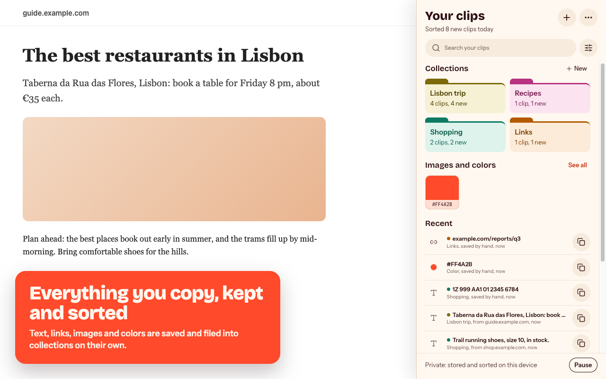

# CopyDrawer

[](https://github.com/marcus-leung/CopyDrawer/actions/workflows/ci.yml)
[](LICENSE)

A private clipboard history for Chrome. Everything you copy is kept, sorted into collections, and ready to paste again. Your clips stay on your computer unless you turn on Google Drive sync.

[Website](https://marcus-leung.github.io/CopyDrawer/) · [Privacy policy](https://marcus-leung.github.io/CopyDrawer/privacy) · [How it works](docs/ARCHITECTURE.md)

> **Status:** v1.0, ready for Chrome Web Store review.



## Features

- **Save anything.** Press Alt+Shift+S on a selection, right-click to save an image, Alt+Shift+D (⌥⇧X on a Mac) to screenshot an area, or paste and drop into the panel. Optional **auto-save** keeps what you copy, including from a site's copy buttons.
- **Never keeps secrets.** Auto-save skips passwords, access keys, private keys and card numbers. It also skips password managers, banks, email, sign-in, government, payment and health sites, plus any site you block.
- **Sorted for you.** Rules file clips into Research, Links, Code, Shopping, Recipes and Personal. Travel clips become trips named after the place, such as "Lisbon trip". Make your own collections, pick their colors, and drag to file and reorder.
- **Finds what you meant.** Best-match search forgives typos, matches word starts, and ranks rare words and titles higher. Filter by type, site and date.
- **Pastes back fast.** Alt+Shift+V opens a quick-paste box in any text field. The toolbar popup is the full app.
- **Copies several at once.** Pick clips in order and copy them as one item. Formatting and images survive in Google Docs, Gmail and Notion.
- **Smart actions.** Track a package, check a flight, add a date to your calendar, open an address in Maps, convert a color, tidy JSON, or strip tracking from a link.
- **Your data, your copy.** Export to a .zip you can read in any browser, and import it back. Auto-delete after 30 or 90 days if you like.
- **Sync if you want it** (off by default). Clips, images and folders sync through a hidden app folder in your own Google Drive. Edits made on two computers merge field by field.
- **Safe on a full disk.** Saving pauses before the disk runs out. If Chrome's database still hits a disk error, CopyDrawer moves your clips to fresh storage at the next start.
- **Made to fit.** Light and dark themes, Default or Monospace font, four text sizes, and a **Hide previews** switch for screen sharing.
- **No pop-ups.** Naming, colors and confirmations happen inside the panel. The only prompts are Chrome's own, when you turn on auto-save or Drive sync.

## How it works

CopyDrawer is a Manifest V3 extension: a service worker, one React app shown in both the side panel and the toolbar popup, content scripts injected only when needed, and IndexedDB storage through Dexie. [docs/ARCHITECTURE.md](docs/ARCHITECTURE.md) walks through each part. Highlights:

- **Auto-save trusts only the user.** Copies a page makes on its own are ignored. A copy button's write counts only within 2 seconds of a real click, once per click, so a page can't fill your history.
- **Secret detection** checks for key formats from AWS, GitHub, OpenAI, Anthropic, Stripe, Slack and Google, for JWTs, and for labelled passwords. Card numbers are verified with the Luhn check.
- **Full-disk recovery.** After a disk error, every page stops writing. At the next start, clips go through a checked rescue copy, in steps that can resume after a crash.
- **Drive sync** merges per field group with tie-breaks that come out the same on every computer. It reads Drive's change feed and falls back to a full compare when needed. A computer's 5,000-clip cap never deletes clips from your other computers.
- **Search** scores whole words, word starts, typos and substrings, then ranks partial matches with a BM25-style score.
- **Quick paste** runs in a closed shadow DOM, so the page can't read your clips. It inserts text in a way that keeps the page's undo history.
- **Permissions stay optional.** Access to all sites is asked for only when you turn on auto-save, and Google sign-in only when you turn on sync. A build check fails if either would ship as required.

## Develop

```bash
pnpm install
pnpm dev          # opens Chrome with the extension loaded and hot reload
```

To load a production build by hand, run `pnpm build`. Then open `chrome://extensions`, turn on Developer mode, choose **Load unpacked**, and pick `.output/chrome-mv3`.

**Drive sync** needs Google's OAuth client. Set `COPYDRAWER_OAUTH_CLIENT_ID` (a "Chrome Extension" client for the store item's ID) when building, or the build hides sync. To sign in from a local build, also set `COPYDRAWER_EXTENSION_KEY` to the store item's public key, so the local build gets the store's extension ID. `pnpm check` fails if the key would ship. Tests use a fake Drive and need neither.

| Command | What it does |
|---|---|
| `pnpm check` | Everything below plus a production build and the manifest check. [CI](.github/workflows/ci.yml) runs it on every push to `main` and on pull requests. |
| `pnpm compile` | Type-check |
| `pnpm lint` | Lint (oxlint: correctness and React hooks rules) |
| `pnpm format` / `pnpm format:check` | Format with Prettier / check formatting |
| `pnpm test` | Unit tests (Vitest) |
| `pnpm test:e2e` | End-to-end tests with the real extension in Chromium (Playwright), including accessibility checks (axe). Specs that read the system clipboard are named `*.clipboard.spec.ts` and run last, one at a time. |
| `pnpm bench` | Measures panel open, search, quick paste and saving at 2,000–20,000 clips (about 5 minutes). Results go to `bench-results.jsonl`. |
| `node scripts/disk-full-test.mjs` | macOS only, by hand, after `E2E=1 pnpm exec wxt build`. Runs Chrome on a small RAM disk, fills it, and checks that no clips are lost (about 3 minutes). |
| `pnpm zip` | Store-ready zip in `.output/` |

## Project layout

```
src/entrypoints/background.ts   service worker: context menus, shortcuts, saving, message routing
src/entrypoints/sidepanel/      side panel app (home, collections, clip detail, settings, onboarding)
src/entrypoints/popup/          toolbar popup (the full app; can expand into the side panel)
src/entrypoints/*.content.ts    auto-save listener, copy-button hook, quick-paste box (injected on demand)
src/lib/                        storage (Dexie), clips, collections and classifier, search, secrets,
                                site exclusions, backup, full-disk guard, smart actions
src/lib/sync/                   Drive sync: change tracking, Drive client, merge, controller
src/components/                 UI building blocks (design system in docs/05)
tests/unit, tests/e2e           Vitest and Playwright tests
tests/bench                     scale benchmark (pnpm bench)
site/                           website and privacy policy, published by GitHub Pages
docs/                           research, design, plans, architecture
```

## Known limitations

- **Right-click → Save image needs auto-save for most images.** Images usually live on another site than the page (an image server), and Chrome blocks downloading them unless the extension has access to all sites. It asks for that only when you turn on auto-save. Without it, the page shows "Image not saved" and says why. Same-site images, and image servers that allow it, save either way.
- **A page can add one clip per click on it.** Copy buttons are saved because a small script in the page reports `navigator.clipboard` writes. A report counts only within 2 seconds of a real click, once per click. After a click, though, a page could report text it didn't copy, and that clip would be saved.
- **A restart with the disk still completely full can skip the clean-up.** After a disk error, CopyDrawer marks the clips to be moved to fresh storage at the next Chrome start. If the disk is too full to write even that mark, and Chrome restarts before any space is freed, the move doesn't happen.
- **Drive sync works in Chrome only,** with the Google account Chrome is signed in to. Other Chromium browsers (Edge, Brave) can't sign in to Google for extensions, so they don't show it.
- **Sync isn't a backup.** A delete, or **Delete all**, reaches every computer that syncs. Export a copy now and then.
- **The first sync downloads every clip one by one.** With thousands of clips it takes a minute or two, and Settings shows the progress. Use counts merge by taking the larger, not by adding up.
- **A clip can be lost while sync is offline for a long time.** If sync can't reach Drive and 5,000 newer clips push a clip out before it uploads, that clip isn't kept anywhere, the same as without sync.
- **Chrome blocks extensions on some pages.** `chrome://` pages, the Chrome Web Store, other extensions' pages and the PDF viewer can't be read by any extension. Auto-save and the shortcuts can't work there. The toolbar icon shows **×** on those pages while auto-save is on. To save from one, copy as usual and use **Grab clipboard** in the panel.

## Contributing

Bug reports and ideas are welcome as [issues](https://github.com/marcus-leung/CopyDrawer/issues). Pull requests aren't accepted yet; see [CONTRIBUTING.md](CONTRIBUTING.md). Report security problems privately: see [SECURITY.md](SECURITY.md).

## License

Copyright (c) 2026 Marcus Leung. Licensed under the [GNU General Public License v3.0](LICENSE) (GPL-3.0-only). You may use, change and share the code, and anything you publish that's built on it must be GPL-3.0 too, with its source. The CopyDrawer name and logo aren't covered: a modified version must use its own.

Third-party licenses are listed in [THIRD_PARTY_NOTICES.md](THIRD_PARTY_NOTICES.md). The build ships their full texts as `THIRD_PARTY_LICENSES.txt`, generated in `wxt.config.ts`.
