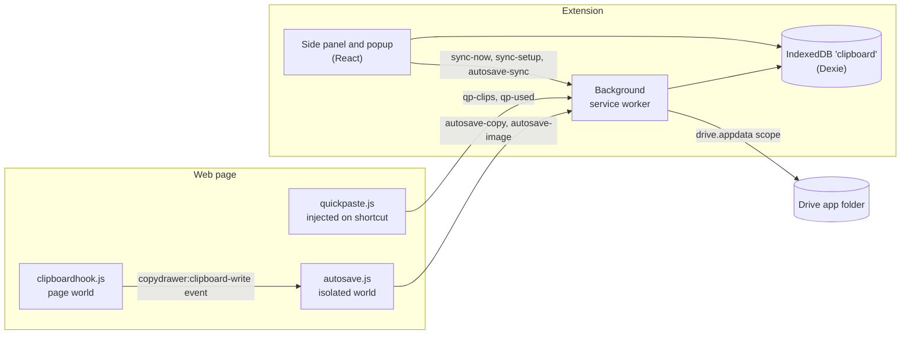

# How CopyDrawer works

A tour of the code for developers. Each section covers one part of the extension: what it does for you, what makes it hard, how the code handles it, and what you can rely on. The source links are the final word if this page and the code disagree.

## The pieces

CopyDrawer is a Manifest V3 Chrome extension built with WXT, React, TypeScript and Dexie. Its code runs in five places:

- **The background service worker** ([background.ts](../src/entrypoints/background.ts)) owns context menus, keyboard shortcuts, alarms, saves that start on a web page, and Drive sync.
- **The side panel and the toolbar popup**, two entrypoints that render the same React `App` ([App.tsx](../src/entrypoints/sidepanel/App.tsx)). The popup passes `surface="popup"`.
- **Two auto-save content scripts**, registered only while auto-save is on.
- **The quick-paste box** ([quickpaste.content.ts](../src/entrypoints/quickpaste.content.ts)), injected into the current tab when you press its shortcut.
- **Small page functions** ([injected.ts](../src/lib/injected.ts)) that the background runs with `scripting.executeScript`, such as reading the selection or showing the "saved" card.

Clips live in one IndexedDB database, `clipboard`, opened through Dexie ([db.ts](../src/lib/db.ts)). Every extension page shares it, so the panel reads and writes clips without going through the background. Settings are in `chrome.storage.local` ([settings.ts](../src/lib/settings.ts)), and short-lived state is in `chrome.storage.session`.

The background treats every message from a page as untrusted and checks the sender's tab and frame before it acts.

## Auto-save capture

With auto-save on, text and images you copy on a web page become clips. That includes what a site's copy button writes.

Copy buttons are the hard part. They call `navigator.clipboard.writeText` or `write`, which fire no copy event, and a content script in the isolated world can't see the page's calls. Also, anything a page can trigger, it can fake to fill your history.

[autosave.ts](../src/lib/autosave.ts) registers two scripts with `scripting.registerContentScripts`:

- `autosave.js` runs in the isolated world ([copyWatcher.ts](../src/lib/copyWatcher.ts)). It listens for `copy` and `cut`, drops events whose `isTrusted` is false, and never reads a password input.
- `clipboardhook.js` runs in the page's world ([clipboardHook.ts](../src/lib/clipboardHook.ts)). It wraps `Clipboard.prototype.writeText` and `write` and, after a write succeeds, fires a `copydrawer:clipboard-write` event.

The isolated script accepts that event only within 2 seconds of a trusted click, then forgets the click. So a page can add at most one clip per real click.

Both scripts load in every frame, including the `about:blank` and `srcdoc` frames where rich-text editors live. Turning auto-save on also injects them into open tabs. After an update, `onInstalled` injects them again and the new copy stops the old watcher. Built-in blocked sites are in `excludeMatches`, so the scripts never load there.

## Secret detection

Auto-save never keeps passwords, access keys, private keys or card numbers. The background runs `secretKind` ([secrets.ts](../src/lib/secrets.ts)) on every auto-saved text before writing it. If it matches, the page says the text wasn't saved and that you can paste it into the panel to keep it.

The difficulty is false alarms. Flagging any text that contains "password" would drop ordinary notes, so the checks are narrow:

- Known key formats. PEM private keys, AWS `AKIA` and `ASIA` IDs, GitHub `ghp_` and `github_pat_` tokens, `sk-` API keys, Stripe `sk_live_` style keys, Slack `xox` tokens, Google `AIza` keys, JSON Web Tokens, and URLs with `user:password@`.
- Labelled lines such as `DB_PASSWORD=...` or `api_key: '...'`. The line must hold only the label and the value. The value must be 8 or more characters with a letter and a digit or symbol, and must not be a path, a URL, or a code reference such as `process.env.TOKEN`.
- Card numbers. 13 to 19 digits, with spaces or dashes allowed, a known issuer prefix, exactly 15 digits for Amex, and a passing Luhn checksum. A number that reads as a parcel tracking number is not a card.

The code would rather miss an unusual secret than skip ordinary text.

## Site exclusions

Auto-save never saves from the 152 built-in sites in [exclusions.ts](../src/lib/exclusions.ts) (password managers, email, sign-in pages, banks, payments, government, tax, credit, payroll, insurance and health portals) or from sites you add. Each entry covers its subdomains, so `gov` covers every `*.gov` site.

Checking only the tab's address leaves gaps. A copy can come from a frame on another site, an editor frame has no address of its own, and `bank.com.` with a trailing dot is a different string from `bank.com`. So the code checks in layers:

- The content scripts are never registered on built-in blocked sites.
- For each copy message, `notSavedHere` checks both the tab's address and the frame's address. A frame without a host belongs to the page around it.
- `hostOf` ([format.ts](../src/lib/format.ts)) lowercases the host and drops a trailing dot and a leading `www.`.
- Incognito tabs are skipped unless you turn on `saveInIncognito`. Pages with no http or https host, such as `chrome://` and `file://`, are always blocked.

Image downloads have one more guard. `isPrivateHost` refuses addresses on this computer or the local network (localhost, single-word names, `.local` and similar suffixes, private IPv4 and IPv6 ranges) unless the page is on one too, and the extension's own fetch sends no cookies and follows no redirects. A public page can't use all-sites access to reach your router.

## Full-disk protection and recovery

When the disk is nearly full, CopyDrawer stops saving and keeps the clips you have.

The danger is subtle. After Chrome's IndexedDB reports a disk error, later writes to that database, even after you free space, can make Chrome discard the whole database at a later start. [storageGuard.ts](../src/lib/storageGuard.ts) defends in three steps:

1. **A margin.** `ensureSpace` refuses a save while less than 50 MB would be free after it (`MIN_FREE_BYTES`). It runs before the save's transaction, never inside one.
2. **A stop after any disk error.** A Dexie middleware in [db.ts](../src/lib/db.ts) watches writes, aborted transactions and unexpected connection closes. On a disk error it sets `storagePaused` (session storage) and `dbRebuild` (local storage), and every write in every extension page is rejected until Chrome restarts and the clips are moved. If the full disk refuses the `dbRebuild` mark, an alarm retries it every 30 seconds.
3. **A rebuild at the next start.** [rebuild.ts](../src/lib/rebuild.ts) runs only in a new Chrome session, and only with room for a full copy plus the 50 MB margin. It copies every table, 50 rows at a time, into a `clipboard-rescue` database and compares row counts. Then it marks the stage `copied`, rebuilds `clipboard` from the rescue copy, and deletes the rescue copy. A crash resumes from the last completed stage.

The panel explains each state and how much space to free.

## Search ranking

Search should find a clip from a few remembered words, typos included, and put the one you meant first. [rank.ts](../src/lib/rank.ts) scores each query word against each clip:

| Match | Score |
|---|---|
| Whole word | 1 |
| Start of a word | 0.8 |
| Small typo of a word | 0.6 |
| Anywhere else in the text | 0.5 |

The typo budget grows with word length. Words under 5 letters get none, words of 5 letters or more get 1 edit, and words of 9 or more get 2.

Common words such as "the" and "where" are ignored unless the query has nothing else. A clip must match one word of a query with up to 3 words, or half the words of a longer one.

Results come in two groups. Clips with every word come first, newest first. The rest follow by a BM25-style score. Rare words count more, title matches count double, each repeat of a word adds less than the one before, and long clips are scaled down for length.

[search.ts](../src/lib/search.ts) adds type, site and date filters and the other orders, which list only clips with every word. Quick paste calls the same `rankByQuery`, so both rank the same way.

## Collections and named trips

New clips sort themselves into Research, Links, Code, Shopping, Recipes, Personal, and trips named after the place, such as "Kyoto trip". [classify.ts](../src/lib/classify.ts) uses rules only, with no network and no model, so the same clip always lands in the same place.

Rules run in a fixed order, and the first match wins. Code and JSON go to Code. Travel, Recipes and Shopping come next, by the source site or by word patterns, and Shopping also takes parcel tracking numbers. Then come code sites, research sites, and plain links. Short texts with an email address, a street address or a phone number go to Personal.

Trips are the hard part. `detectDestination` counts mentions of 86 places, case-sensitive so "Nice" the city doesn't match "a nice day". Neighborhoods count toward their city, so Gion and Arashiyama add to Kyoto. A travel clip that names no city ("check-in 15:00") joins the trip with the newest clip from the last 14 days ([collections.ts](../src/lib/collections.ts)).

Rules never move a clip you placed yourself. Moving one sets `collectionLocked`, which `autoAssign` respects.

## Drive sync

Sync keeps the same clips, images and folders on every computer where you turn it on. It is off by default and uses only the `drive.appdata` scope, a hidden app folder that can't see your other Drive files. Each row is one file there ([record.ts](../src/lib/sync/record.ts)).

Merges must give the same result on every computer, whatever order changes arrive in:

- **Per-group change times.** [meta.ts](../src/lib/sync/meta.ts) records when each group of fields last changed (content, title, note, pin, place, and so on), so a pin on one computer and an edit on another both survive. A change is stamped later than any time the row already carries, so a clock running ahead elsewhere can't beat a newer edit.
- **Deterministic ties.** Equal times go to the larger value. Created and used times and use counts take the larger value.
- **Deletes.** A delete wins unless a group changed after it. Tombstones stay in Drive for 60 days, so a computer that was off still hears of the delete.
- **Duplicates.** The same text or image saved on two computers becomes one clip. Two folders with the same key, such as two "Research" folders, merge, and the clips of the losing folder move to the winner. The smaller id wins in both cases, so every computer picks the same row.

## Drive sync: interruptions and edge cases

Every step in [engine.ts](../src/lib/sync/engine.ts) can be cut short and run again:

- **Change feed.** A pull reads Drive's change list, saving its page token after each page. If Drive refuses an old token, sync falls back to a full comparison. A file missing from a listing is asked for by id before the row is dropped, because listings can miss files.
- **Seen only after applied.** A merged file's checksum is recorded only after every write it caused. A sync cut short merges that file again.
- **Uploads.** Each row carries a revision number. A push clears the row's `dirty` mark only if the row didn't change while it was uploading.
- **The 5,000-clip cap.** Each computer keeps at most 5,000 clips ([clips.ts](../src/lib/clips.ts)). Clips that don't fit are marked `evicted`, not deleted, so they stay in Drive and on computers with room.
- **A deleted Drive copy.** A `copy` marker file holds a random id. Before any removal from Drive deletes a clip here, sync checks that the marker still exists and holds the same id. If someone deletes the app data in Drive, the other computers stop and keep their clips until you choose **Sync again**.

[drive.ts](../src/lib/sync/drive.ts) retries rate limits and server errors up to 4 times with jittered backoff. It doesn't retry a create after a server error, because that error can arrive after Drive already made the file.

## Copy several clips at once

You can pick several clips and copy them as one clipboard item, with each clip's formatting and images in order. [multiCopy.ts](../src/lib/multiCopy.ts) builds a plain-text version and an HTML version of the same content.

The hard part is that each saved clip's HTML is a whole clipboard document, with `<meta charset>`, styles and sometimes `<head>`, so joining them as-is gives a broken document. Google Docs also keeps a `docs-internal-guid` id on what it copies, and pasting HTML that carries one makes Docs paste its own stored copy of that one clip instead.

`fragmentOf` keeps only the body content and removes styles, scripts, comments and that id. Clips are wrapped in `
` for the new line and blank line joins, or in `` for the space and comma joins. Images go in as data URLs, capped at 20 MB in total. If a page rejects the HTML, plain text still goes through. One picked clip copies exactly as its own Copy button would.

[join.ts](../src/lib/join.ts) holds the separators. Quick paste into a one-line input, which drops line breaks, puts a space between clips instead.

## Quick paste

Alt+Shift+V opens a search box over the page and pastes the chosen clips where you were typing. It's injected with `activeTab`, so it needs no site access.

Several problems shape [quickpaste.content.ts](../src/entrypoints/quickpaste.content.ts):

- **The page can't read the clips.** The box lives in a closed shadow root. The background sends the clip list only to the tab where you just opened the box, only to its top frame, and only within 30 seconds. The list holds at most 300 text clips, pinned ones first, then the newest.
- **Keys typed before the clips arrive.** The service worker may still be waking up, so early keys are queued and replayed in order once the clips load.
- **Input methods.** Keys pressed while a Chinese, Japanese or Korean input method is composing (`isComposing`, or `keyCode` 229) go to the input method, not the box.
- **Undo.** Text goes in with `document.execCommand('insertText')`, which keeps the page's undo history and fires the events frameworks listen for. If that fails, the code sets the value and fires `input` itself.

## Backup, export and import

Export writes a .zip ([backup.ts](../src/lib/backup.ts)):

- `clips.html` is a page you can read in any browser, grouped by collection ([backupPage.ts](../src/lib/backupPage.ts)).
- `clips.json` is what Import reads.
- `images/1.png`, `images/2.jpg` and so on are the full-size images, named by position and stored uncompressed.

The zip is built one file at a time, so the panel stays responsive and one image's bytes can be freed before the next is read.

Import treats the file as untrusted. It reads only the shallowest `clips.json` (up to 200 MB), images up to 20 MB each, and at most 5,010 entries. Every field is type-checked and length-capped. Hashes are recomputed and previews rebuilt instead of trusted from the file. A clip keeps its id only if the id is short, safe and unused, and a creation date in the future is moved back to now. Collections match by key, so "Research" isn't duplicated. Import never deletes clips to make room. It reports how many it added, skipped as damaged, and left out for lack of room. Older single-file `.json` exports still import.

## Privacy and permissions

The install asks only for what the default features need. Two permissions are optional and requested at the moment you turn a feature on ([wxt.config.ts](../wxt.config.ts)):

- **All-sites access** (`optional_host_permissions: ["<all_urls>"]`) when you turn on auto-save. Turning auto-save off gives the access back.
- **`identity`** when you turn on Drive sync, with the `drive.appdata` scope only.

WXT would grant the matches of runtime-registered scripts at install, so the build deletes `host_permissions` from the generated manifest. [check-manifest.mjs](../scripts/check-manifest.mjs) then fails the check if the shipped manifest has `host_permissions`, a `key`, or `identity` as a required permission, or if a bundled dependency's license is missing.

All code ships in the package, with no remote scripts and no analytics. The extension makes network requests only to download an image you save and, when you turn it on, for Drive sync.

## How it's tested

**Unit tests.** Vitest runs against `fake-indexeddb` ([vitest.config.ts](../vitest.config.ts)), so storage, sync and import tests use real Dexie transactions.

**A messy fake Drive.** [fakeDrive.ts](../tests/unit/fakeDrive.ts) is as untidy as Drive. Change entries show files as they were when they changed, listings come in any order or miss files, old page tokens get refused, and "Delete hidden app data" removes files in any order. [fakeDriveServer.ts](../tests/e2e/fakeDriveServer.ts) serves the same fake over HTTP for the end-to-end sync tests.

**End-to-end tests.** Playwright loads the real extension into Chromium. The test build (`E2E=1`) grants all-sites access and adds message hooks for what Playwright can't do, such as clicking a context menu. Specs that read the system clipboard are named `*.clipboard.spec.ts`, and [e2e.mjs](../scripts/e2e.mjs) runs them one at a time after the rest. It fails if a spec reads the clipboard without that name. axe checks accessibility on each screen in the light theme, and on the home screen in the dark theme ([setup-and-a11y.spec.ts](../tests/e2e/setup-and-a11y.spec.ts)).

**By hand.** `pnpm bench` ([scale.bench.ts](../tests/bench/scale.bench.ts)) measures panel open, search, quick paste and saving at 2,000 to 20,000 clips. [disk-full-test.mjs](../scripts/disk-full-test.mjs) runs Chrome on a 256 MB RAM disk on macOS, fills it, and checks that no clips are lost.

**`pnpm check`** runs the type check, lint, format check, unit tests, a production build, the manifest check and the end-to-end tests. CI runs it on pushes to `main` and on pull requests ([ci.yml](../.github/workflows/ci.yml)).
